# TaskFlow API

Task Management API aka TaskFlow API was originally created for Module 3 assignment. As the name suggests, it is a Spring Boot task-management API with:

1. A layered architecture consisting of controller, model, repository and service layers to manage the flow of tasks in the backend
2. REST API endpoints  to create, read, update, delete, and summarise tasks in the backend.


 As there is no database, tasks are stored in memory, so they will not persist after the application stops or restarts.

For Module 4 assignment, TaskFlow API is containerised as a Docker image using a multi-stage Maven build and deployed on Render.


## Live Application URL

Render live application URL: https://task-management-api-0kea.onrender.com

## Screenshots
### Render dashboard with active deployment
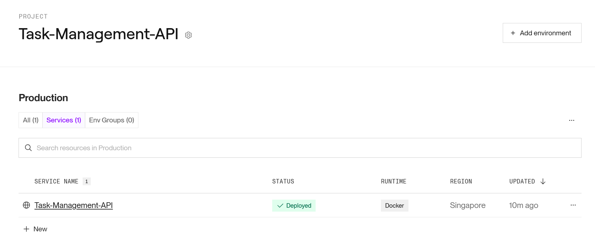
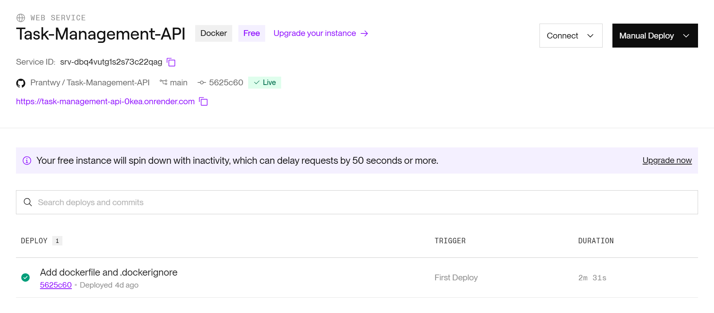

### Deployment to Render succeeded
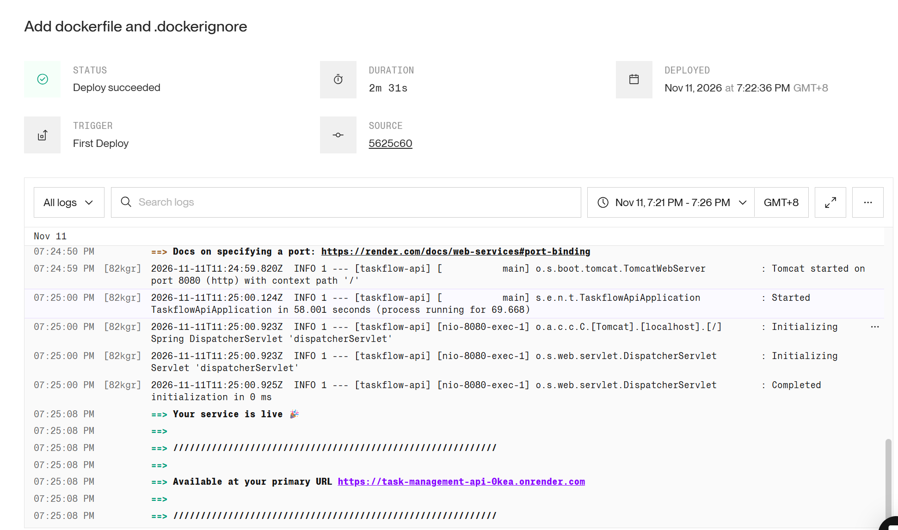

### Live application URL is working
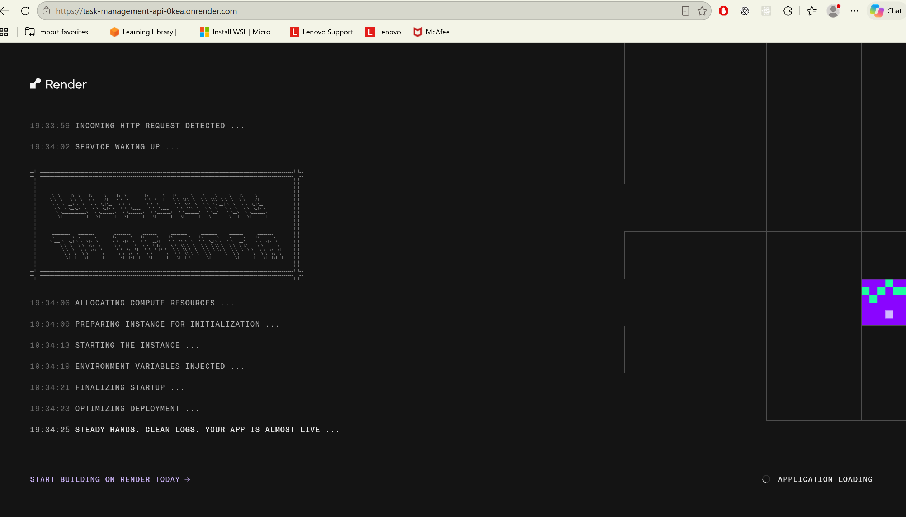


## REST API Endpoints

| Method     | Path                          | Description                                          |
| ---------- | ----------------------------- | ---------------------------------------------------- |
| `GET`    | `/api/tasks`                | List tasks (an empty list if none have been created) |
| `GET`    | `/api/tasks/{id}`           | Get a task by ID                                     |
| `POST`   | `/api/tasks`                | Create a task                                        |
| `PUT`    | `/api/tasks/{id}`           | Update a task                                        |
| `DELETE` | `/api/tasks/{id}`           | Delete a task                                        |
| `PUT`    |  `/api/tasks/{id}/complete` | Mark a task complete                                 |
| `GET`    | `/api/tasks/summary`        | Generate a plain-text AI summary of the task list    |


Example request to create a task:

```bash
curl -X POST http://localhost:8080/api/tasks \
  -H 'Content-Type: application/json' \
  -d '{"title":"Test deployment"}'
```
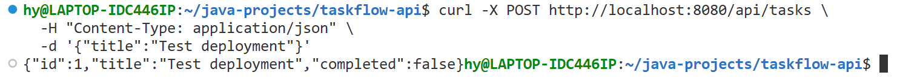

The summary endpoint uses the configured OpenRouter OpenAI key and requires an `OPENAI_API_KEY` environment variable.

Keep the key in an environment variable in ~/.bashrc:
```bash
export OPENAI_API_KEY=(Copy_and_paste_your_OpenAI_API_key_here)
```
In your 'application.properties' file, refer to it like this: spring.ai.openai.api-key=${OPENAI_API_KEY} 

```bash
# Spring AI - OpenRouter Configuration
spring.ai.openai.api-key=${OPENAI_API_KEY}
spring.ai.openai.base-url=https://openrouter.ai/api/v1
spring.ai.openai.chat.model=openrouter/free
spring.ai.openai.embedding.model=nvidia/llama-nemotron-embed-vl-1b-v2:free
spring.ai.openai.embedding.encoding-format=float
```

## Run locally

Requires Java 21 and Docker (or Maven to run without Docker). From the repository root:

Build Docker image:
```bash
docker build -t taskflow:latest .
```
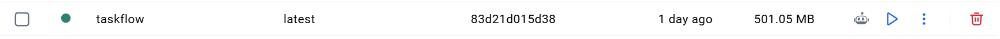

Run the container:
```bash
docker run -p 8080:8080 taskflow:latest
```
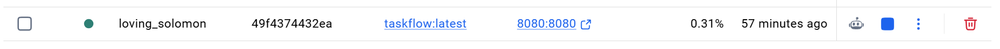

Then test the API:

```bash
curl http://localhost:8080/api/tasks
```
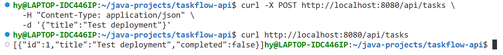

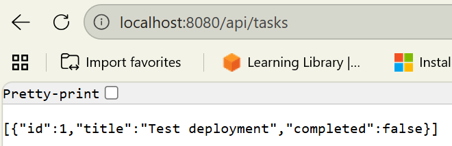


To run with Maven instead, set `OPENAI_API_KEY` in your environment and run `./mvnw spring-boot:run` (Windows: `mvnw.cmd spring-boot:run`). The Dockerfile builds the JAR in a Maven stage and runs it on the Java 21 JRE image, exposing port `8080`.


## Deploy to Render

1. Create a new **Web Service** in Render and connect this GitHub repository.
2. Select Docker as the runtime/build method so Render uses the repository's `Dockerfile`.
3. Set the `OPENAI_API_KEY` environment variable in the Render service settings.
4. The application listens on port `8080`. Set PORT as an environment variable to `8080`.
5. Test the live deployment with a POST request to create a task.
```bash
curl -X POST https://task-management-api-0kea.onrender.com/api/tasks \
  -H "Content-Type: application/json" \
  -d '{"title":"Test deployment","completed":true}'
```
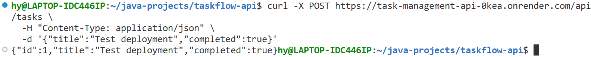

6. Verify the deployment with `curl https://task-management-api-0kea.onrender.com/api/tasks` 


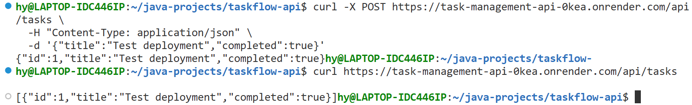

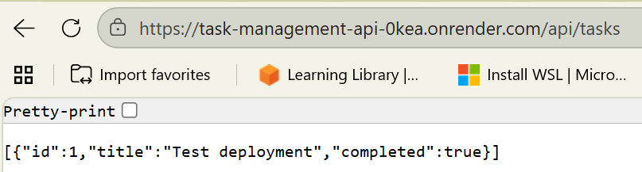


# Stretch Goal
### Option 4: Publish versioned Docker images

2 taskflow Docker images, `1.0.0` and `1.0.1`, were built and pushed to Docker Hub. Images use Semantic Versioning (SemVer). 

### Semantic Versioning (SemVer) Format

```
MAJOR.MINOR.PATCH
```

- **MAJOR** – Incompatible API changes (breaking changes)
- **MINOR** – Backwards-compatible feature additions
- **PATCH** – Backwards-compatible bug fixes


### Example:
Starting version: `1.0.0`
| Change | New Version | Reason |
|--------|-------------|--------|
| Fix bug in login | `1.0.1` | Patch - bug fix |
| Add new "export" feature | `1.1.0` | Minor - new feature |
| Change API response format | `2.0.0` | Major - breaking change |


### Docker Image Tags

The `latest` tag points to the newest release, currently `1.0.1`. 


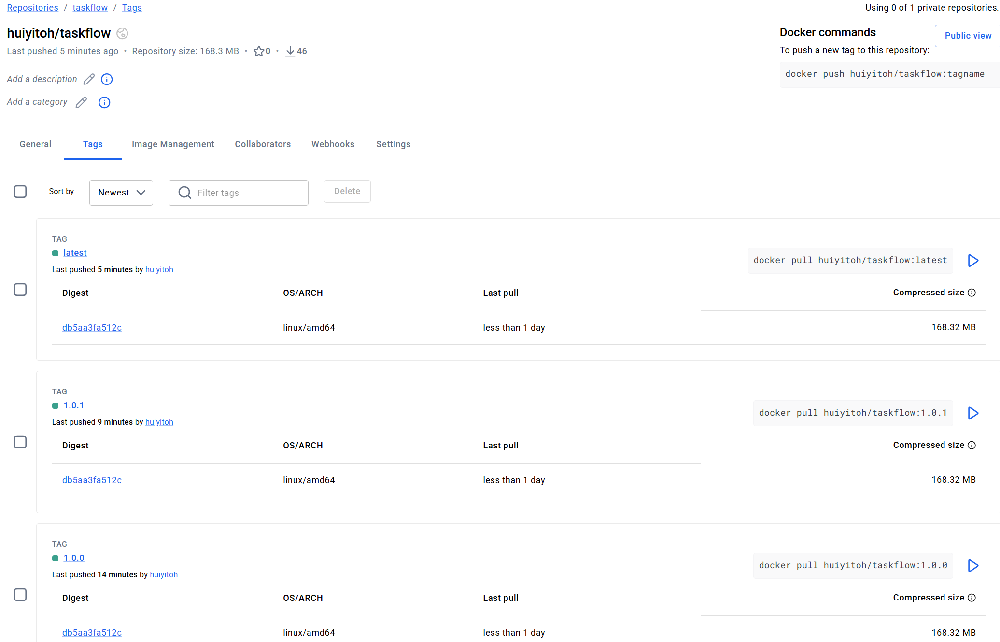


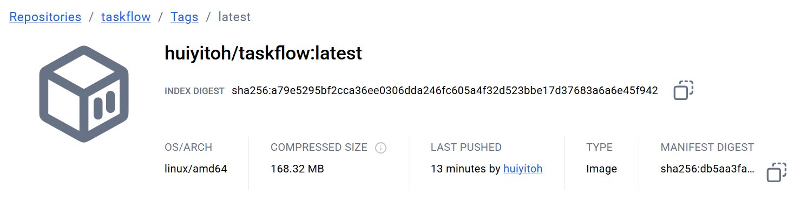

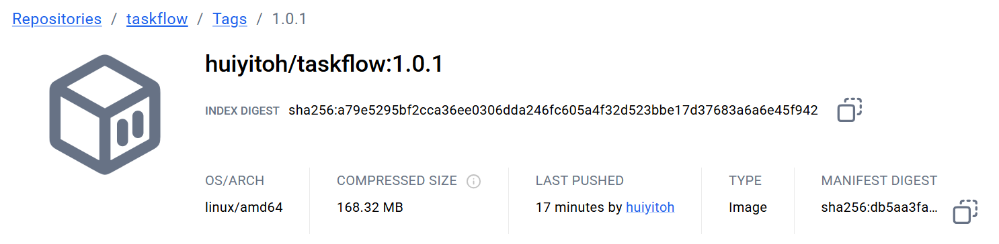

Same index digests mean that both version tags, `1.0.1` and `latest`, point to the same build of the image. 

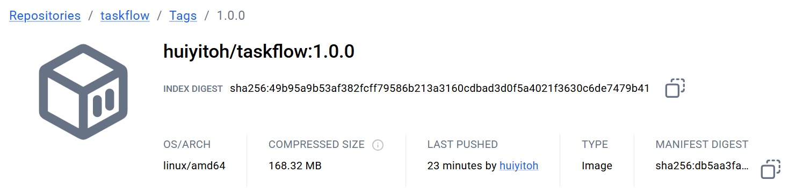

The `1.0.0` tag has a different digest as it represents the previous build of the image.